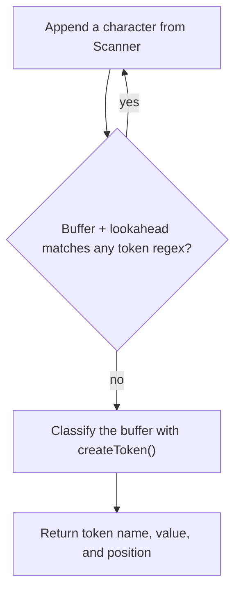
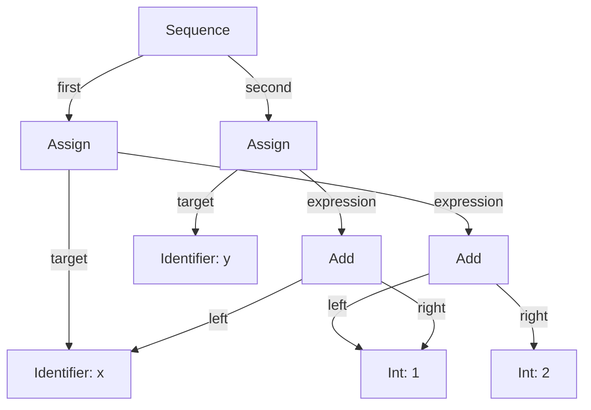
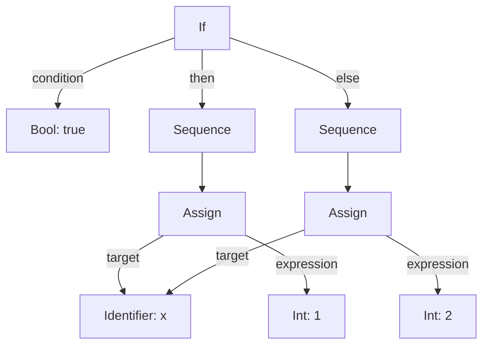

# Prison

A C++11 interpreter project for a small, C-like language, exploring lexical
analysis and AST evaluation. It includes a character scanner, a regex-based
lexer, and a separate AST evaluation prototype with integer and boolean values, variables, operations,
and branching. The `grammar` file contains a grammar sketch;
the parser that would turn source code into an AST is not implemented yet.

The name *Prison* is a visual nod to *Bison* and to the COVID lockdown and curfew during which I worked on the project.
I started it as a learning project because I was curious about how interpreters work and wanted to learn C++.

## Build and run

Requires a C++11-compatible compiler, CMake, and a build tool such as Make.
Verified on macOS with Apple Clang 21 and CMake 3.23.2.

From the repository root:

```sh
cmake -S . -B build
cmake --build build
./build/prison
```

The program reads `test.syntax` from the working directory. The filename is
currently hardcoded in `src/main.cpp`; edit `test.syntax` to try another example.
The `buildandrun.sh` script automates the build and run steps and also creates
a `prison` symbolic link to the executable.

## Language example and current behavior

```c
int one = 1;
float two = 2.0;
int three = one + two;

if (three != 4) {
    one = 2;
}
```

This illustrates the intended syntax for declarations, addition, comparison,
and branching. Type handling and full program execution are not complete yet.

The executable currently only tokenizes its input: after `Prison running`,
it prints each token's name, value, and `line:column` position, then ends with
`OK`. For example, `int one = 1;` produces `type_int`, `id`, `assign`, `int`,
and `semicolon` tokens; spaces and line breaks appear as separate `space` and
`nl` tokens. The token names for `if` and `!=` are `if` and `not_equals`.

**Known bug:** token values point to a buffer that the lexer frees before
returning the token, so printed values may be missing or garbled.

**Demo behavior:** the executable runs the lexer and lists tokens. AST
evaluation is demonstrated separately in the examples below.

## How tokenization works

`Scanner` reads characters and tracks their positions, keeping one character
of lookahead. `Lexer::shift()` appends characters to a buffer. After each
character, `regexBroken()` tests the buffer **plus the next character** against
the token regexes. If any regex matches that whole candidate, scanning
continues. Otherwise, the lexer stops and `createToken()` classifies the buffer,
leaving the lookahead character for the next token.



For example, while reading `cat + 2;`, the identifier is collected as follows:

| Buffer | Lookahead | Candidate tested | Decision |
| --- | --- | --- | --- |
| `c` | `a` | `ca` | Matches `id`: continue |
| `ca` | `t` | `cat` | Matches `id`: continue |
| `cat` | space | `cat ` | No match: classify `cat` as `id` |

The same process handles the remaining text as `space`, `plus`, `space`, `int`,
and `semicolon` tokens. This illustrates the scanning decisions, rather than
the currently unreliable printed token values.

This is a lexer with lookahead, rather than a shift–reduce syntax parser:
there is no stack of grammar symbols being reduced into expressions here.
Despite its name, `parseStack` is a character buffer.

Quoted strings are not handled reliably yet.

### Parser sketch

The `grammar` file sketches productions with semantic actions:

```text
ADD:
    EXPRESSION '+' EXPRESSION {
        add $1 $3
    }
;
```

Here, `$1` and `$3` refer to the left and right expressions. The action sketches
how an addition node could be constructed when that rule is recognized. These
rules are not consumed by the executable, and this sketch does not define
operator precedence.

## AST evaluation

The AST can be built and evaluated directly in C++, independently of the lexer.
Each node represents a value, expression, or statement.

`Scope` is a symbol table that maps variable names to value nodes: `Assign`
stores evaluated values there, and `Identifier` retrieves them.
`Sequence` groups statements and evaluates them in the order they were appended,
passing the same scope to each one so later statements can use earlier assignments.

This example constructs the equivalent of `x = 1 + 2; y = x + 1;` using the
classes in `include/Prison/AST/`:

```cpp
using namespace Prison::AST;
using namespace Prison::AST::Types;
using namespace Prison::AST::Operations::Binary;
using namespace Prison::AST::Statements;

Scope scope(new Prison::Util::Generic::HashMap<Node *>());
Identifier x("x"), y("y");
Int one(1), two(2);
Add sum(&one, &two);
Assign setX(&x, &sum);
Add increment(&x, &one);
Assign setY(&y, &increment);

Sequence program;
program.append(&setX); // x = 1 + 2
program.append(&setY); // y = x + 1
program.evaluate(&scope);

std::cout << dynamic_cast<Int &>(y.evaluate(&scope)).getValue() << '\n'; // 4
```

The graph below shows the AST structure, including the shared `x` and `one`
objects.



### How addition is evaluated

Expressions are evaluated recursively in postorder: child expressions are
evaluated before the parent operation.

`Add::evaluate()` evaluates both child nodes in the same scope, then applies
the overloaded `+` operator to their results. From
[`Add.h`](include/Prison/AST/Operations/Binary/Add.h):

```cpp
virtual Node & evaluate(Scope * scope) {
    return m_left->evaluate(scope) + m_right->evaluate(scope);
};
```

For integer operands, this calls `Int::operator+`, which creates a new `Int`
containing their sum. From [`Int.h`](include/Prison/AST/Types/Int.h):

```cpp
virtual Int & operator+(Node & i) {
    Int * newInt = new Int(m_number);
    const Int * otherInt = dynamic_cast<const Int *>(&i.evaluate());

    newInt->m_number += otherInt->m_number;

    return * newInt;
}
```

In the example above, `sum.evaluate(&scope)` therefore returns an `Int` with
value `3`. An operand can also be another expression or an identifier: its
`evaluate(scope)` call computes the nested expression or looks up the variable.

### A simple branch

Using the same namespaces, this example builds the equivalent of
`if (true) { x = 1; } else { x = 2; }`. The `If` node takes a `Bool` condition
and a `Sequence` for each branch.

```cpp
Scope scope(new Prison::Util::Generic::HashMap<Node *>());
Bool condition(true);
Identifier x("x");
Int one(1), two(2);
Assign setOne(&x, &one);
Assign setTwo(&x, &two);

Sequence thenBranch, elseBranch;
thenBranch.append(&setOne);
elseBranch.append(&setTwo);

If branch(&condition, &thenBranch, &elseBranch);
branch.evaluate(&scope);

std::cout << dynamic_cast<Int &>(x.evaluate(&scope)).getValue() << '\n'; // 1
```



The `testAST()` function in `src/main.cpp` contains a larger example with
comparison and `if`/`else` nodes; it is disabled in `main()` by default.
